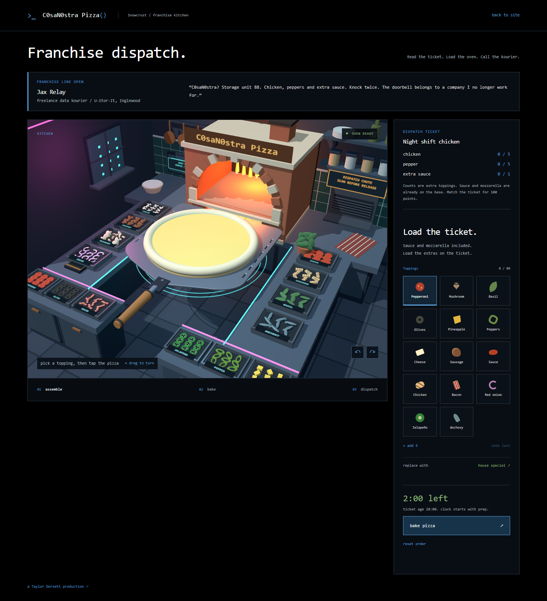
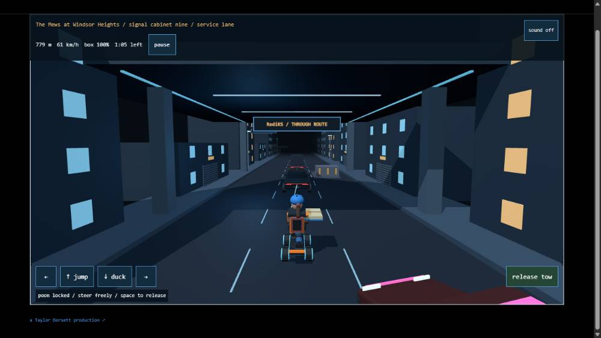
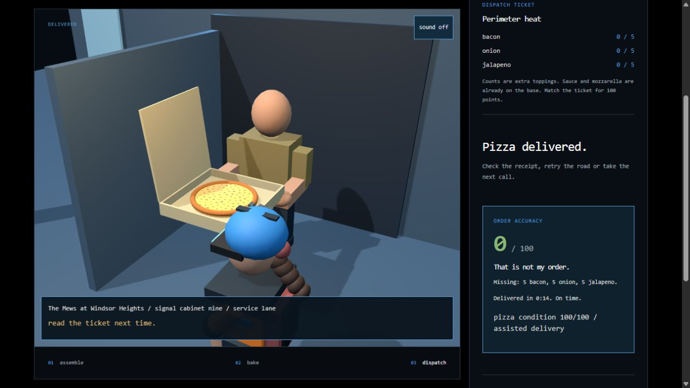
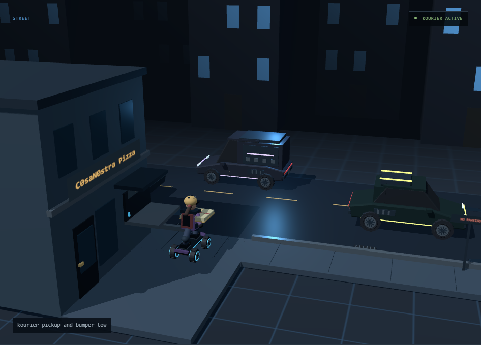

# Snowcrust

make the pizza. catch a tow. get it there in one piece.

[play Snowcrust](https://www.taylordorsett.com/snowcrust/)

a small 3d pizza game set around C0saN0stra Pizza. take a call, match the toppings, bake it and skate the delivery. the customer opens the actual pizza you made.

Snowcrust is the project name. C0saN0stra Pizza is the restaurant.

## how it works

six callers order from a menu of 14 toppings. sauce and mozzarella are already on the base. the ticket shows the extras they want.

you get two minutes once prep starts. the ticket is already 28 minutes into the franchise's thirty minute guarantee. the clock keeps running through pickup and the road. pause and the controls screen stop it. arrival freezes it before the handoff. being late does not stop the order.

the customer scores the pizza from 0 to 100 based on the toppings. extras count against you. inspecting a slice lets you take a bite, which costs 10 points. delivery time and pizza condition are separate. hitting traffic damages the box and shifts the slices. it does not change which toppings you cooked.

reset clears the pizza and timer but keeps the caller. next call changes the customer. replay handoff opens the same box again with the original result.

retry delivery is practice. it starts the same road with your pizza and the time you had when skating began. it keeps the original receipt.

## on the road

one authored 960 metre route. three lanes. moving traffic, parked cars, road work and overhead frames. the street passes dispatch frontage, an overpass and a franchise boundary. a clean scripted run takes about 54 seconds. there is always a clear path. the road has its own 90 second limit. missing the franchise guarantee lowers your delivery result but does not end the road.

| action               | keyboard          | phone               |
| -------------------- | ----------------- | ------------------- |
| change lane          | arrows or A and D | swipe left or right |
| jump                 | up or W           | swipe up            |
| duck                 | down or S         | swipe down          |
| catch or release tow | space             | hook button         |
| pause                | escape            | pause button        |

touch buttons work too. the controls stay inside the play area.

riding tips teach steering, jump timing, duck timing, release and another catch as you reach them. the matching button gets an outline. tips follow your lane and current tow. turn them off in the pause menu. all controls are there too.

the full pickup plays first, including the hook and pull away. you start the road attached. fifteen cars cruise at 72 km/h with room between them. a clean run keeps a tow for long stretches. free skating settles at 50 km/h and can finish without catching another car.

one press or swipe moves one lane. the tow supplies speed while you steer, jump and duck. the low coupe fits under a beam that you still need to duck under.

a green marker and fire button show when a bumper is reachable. the poon takes time to reach it. junction warnings show distance, the car exit and the straight delivery route. release before your tow turns. holding on shows the turn, then cuts the line and costs 15 cargo points. releasing keeps your momentum.

traffic contact damages the box and slows you down. solid barriers stop you until you move around them. they do not let you skate through. losing the cargo or running out of road time ends the run. retry keeps the pizza you made.

pause also works when you switch tabs. the slower road option removes collision damage and marks the receipt as assisted. automatic delivery skips the road and keeps the customer ending.

sound starts off. turn it on in the scene for wheels, traffic, the tow latch and delivery cues. every important cue has text too.

## at the door

the destination appears ahead. traffic turns away and the last twenty metres coast into the forecourt. park the board and hand over the box. reset stays available beside the handoff button. the customer's address selects a storage unit, gatehouse, motel or dispatch booth. the pizza keeps its toppings, browning and bite. damage moves the slices inside the box.

if you took a bite, they notice.

## run it

use Node 24.

    npm ci
    npm run build
    npm start

open [localhost:5177](http://localhost:5177). rebuild after changing the source. the server serves dist, so there is no automatic reload.

## check it

    npm run lint
    npm run format:check
    npm test
    node scripts/audit-delivery.js
    npx playwright install chromium
    npm run test:browser

install Chromium once. on Linux, use npx playwright install with the --with-deps option if the browser needs system packages.

the browser checks build their own copy and start a server on a free port. they cover desktop, mobile, baking, pickup, steering, swipes, pause, practice, scoring, reset, old recipe links and reduced motion. all six customer endings are checked. repeated deliveries must reuse GPU buffers. sound checks cover starting, pausing and muting the audio graph. screenshots go in artifacts/screenshots.

use npm run format to format the code. look at the actual changed area on desktop and mobile before pushing. add screenshots to the PR.

## where things live

| folder         | what belongs there                                      |
| -------------- | ------------------------------------------------------- |
| src/kitchen/   | pizza, ingredients, oven, peel and cooking motion       |
| src/delivery/  | pickup, road rules, traffic, sound and customer handoff |
| src/order/     | order flow, callers, score, timer and recipe data       |
| src/ui/        | page updates and pointer controls                       |
| src/scene/     | renderer, camera, city and shared scene helpers         |
| src/styles/    | page styles                                             |
| scripts/       | build, local server and browser test runner             |
| tests/unit/    | scoring, recipes, route rules and pizza snapshot checks |
| tests/browser/ | browser flows and screenshot helpers                    |
| docs/          | architecture, world references and saved PR screenshots |
| artifacts/     | generated test output, ignored by git                   |
| dist/          | generated site, ignored by git                          |

index.html is the page. src/app.js connects the scene, kitchen and order controller.

[architecture and editing guide](docs/ARCHITECTURE.md) / [delivery review](docs/DELIVERY_REVIEW.md) / [world references](docs/WORLD.md)

## publishing

GitHub Actions runs the checks on PRs and on main. merging to main publishes through GitHub Pages.

the build copies the page, source and Three.js into dist. tests, docs and screenshots are not published. everything is static. there is no backend.

built with Three.js. needs WebGL. reduced motion removes banking and camera transitions. old recipe links still work, but there is no share button.

## spec and review

[delivery spec](docs/DELIVERY_SPEC.md) defines the expected behavior. [interaction audit](docs/INTERACTION_AUDIT.md) records played outcomes, automated checks, recovery results and remaining gaps.

## current scope

this is one finite delivery road with different customer doorsteps. separate road layouts, shortcuts, local bests and a full shift can come later.

browser checks use Chromium and emulated phone sizes. physical phone performance still needs real device testing.

MIT license.
