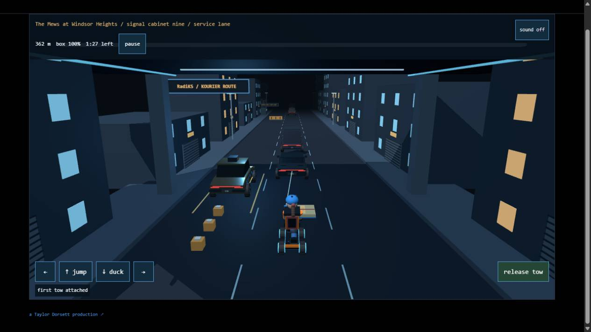
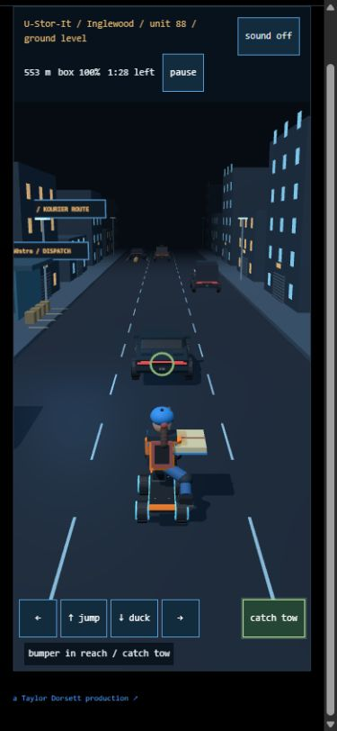
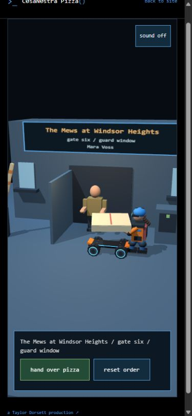

# delivery review

this pass keeps the pizza delivery and the existing art. the runner comparison is about readable movement, useful choices and a clear ending.

## what changed

| part                   | result                                                               | review                                                                 |
| ---------------------- | -------------------------------------------------------------------- | ---------------------------------------------------------------------- |
| forward traffic        | cars have independent world positions and speeds                     | direction and spacing tests plus full runs                             |
| longer towing          | the first car supports more than twenty seconds of continuous towing | a ducked beam run held the first tow for about 33.6 seconds            |
| control while attached | carve, jump and duck without dropping the line                       | input tests and browser movement review                                |
| traffic choices        | ten cars with different speeds and a reachable bumper window         | four cars ahead at dispatch, blocked hooks rejected                    |
| road framing           | the road gets the full page width with a closer chase camera         | desktop, portrait and landscape screenshots                            |
| skating                | connected joints, a push foot, crouch, jump anticipation and landing | joint clearance tests and motion review                                |
| obstacles              | parked bays, service work and a beam that matters while towing       | jump and duck tests plus impact review                                 |
| exits                  | cars signal and turn through a cleared side street                   | over three seconds of warning, turn geometry tests and recorded frames |
| street progression     | dispatch frontage, overpass, franchise boundary and delivery access  | full route review, camera blocking sign fixed                          |
| recovery               | a bump slows you and damages the box once                            | no lane teleport, no backwards step, no passing through moving cars    |
| arrival                | the actual doorstep appears ahead and parking follows the approach   | desktop and phone approach review, exact pizza and bite checks         |
| phone controls         | reachable target cue, thumb buttons and rotation handling            | portrait, landscape and touch input checks                             |

## checks

45 unit tests cover the order, pizza, delivery model, traffic, guidance and movement. the rapid input test runs thirty repeatable deliveries and checks traffic clearance and completion. lint and formatting are checked too.

the browser suite covers desktop and phone layouts, keyboard and touch controls, pause, reset, replay, practice, all six customers, bitten pizza reactions, frozen receipts and GPU buffer reuse. the rotation check verifies the HUD stays on screen.

visual review caught a car crowding the rider, an overhead sign covering the camera, a cropped phone destination sign, a hidden reset button and a clipped HUD after rotation. the final stress pass also found an ongoing merge that needed another clearance check. those were fixed before their changes were pushed.

the screenshots are review evidence, not pixel baselines. the browser tests generate their own screenshots under artifacts.

## limits

this is still one finite route. different callers share it and get different doorsteps. the streets are an adaptation, not a map of the novel.

the phone checks use Chromium at phone sizes. physical iPhone and Android performance is still unverified. the emulated browser checks do not establish a real device frame rate.

traffic is authored and deterministic. there is no procedural traffic generator or multiplayer simulation. no coins, upgrades or shop were added.
