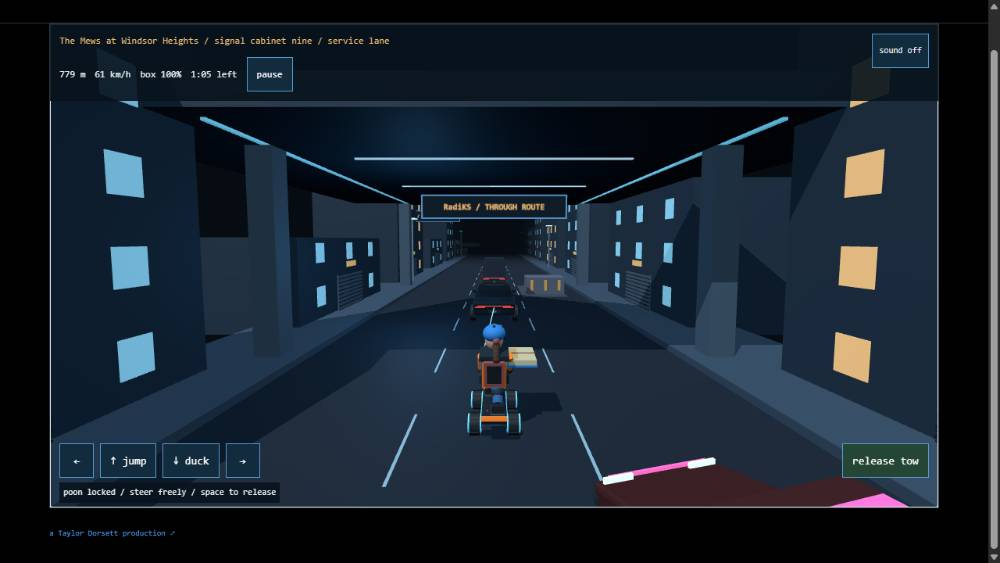
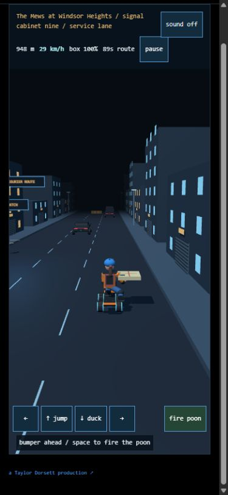

# delivery review

this is the earlier review, kept as history. its speed, starting tow and exit failure descriptions are superseded by the [current spec](DELIVERY_SPEC.md) and [interaction audit](INTERACTION_AUDIT.md).

this pass fixes the part that was not working. the road needs player input, traffic gives you a reason to catch a tow, and a missed action can end the delivery.

## what changed

| part      | result                                                                    |
| --------- | ------------------------------------------------------------------------- |
| lanes     | one press moves one lane in 0.18 seconds                                  |
| traffic   | fifteen cars move forward at their own speeds                             |
| towing    | manual catch, visible hook flight, separate release and retained momentum |
| route     | 960 metres with two sustained tows in a clean run                         |
| failure   | wrong exit, lost cargo or 90 seconds on the road                          |
| obstacles | solid barriers stop you instead of letting you phase through              |
| retry     | starts the road again with the same pizza                                 |
| cargo     | the same box and grip through pickup, skating and customer handoff        |
| phone     | the camera follows the rider so outside lanes stay visible                |

## review

a full run with normal controls reached the customer with the box intact. it used two tows and about 67 seconds of road time. the first part was reviewed on desktop and the second part at phone size. a separate run checked the wrong exit failure.

review caught the retry buttons staying disabled, the box changing size, the lid hiding the customer and the courier leaving the phone view in outside lanes. those were fixed. both phone outside lanes were then reviewed again.

41 unit tests cover scoring, motion, collisions, hook timing, failure, a clean route, cargo clearance and camera framing. browser checks cover keyboard and touch, pause, failure, retry, replay, reset, every customer, bitten pizza, audio and buffer reuse.

## limits

one authored route. callers share the road and get their own doorstep. it is a game adaptation of the setting, not a map of the novel.

phone checks use Chromium at phone sizes. physical iPhone and Android performance still needs device testing. screenshots and automated checks do not establish a real device frame rate.

traffic is deterministic. there is no procedural city, multiplayer, currency or upgrade shop.
