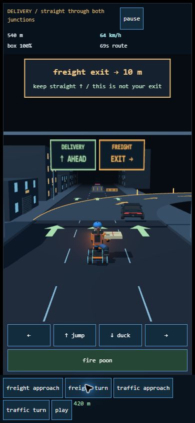
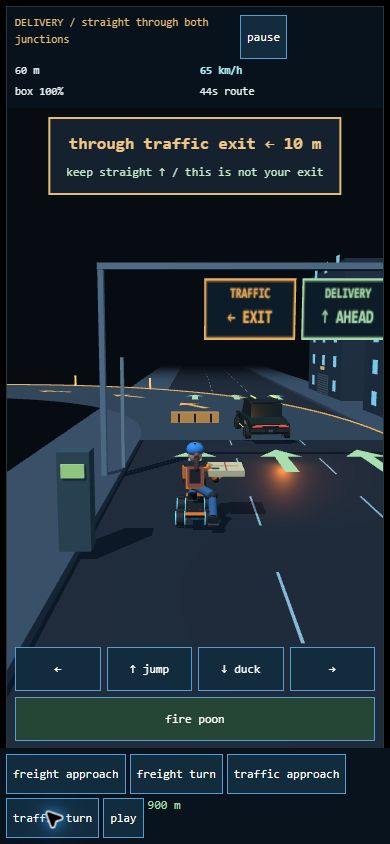

# exit review

Both junctions now have advance signs, signs at the fork and repeated pavement arrows. Green means the delivery road continues straight. Amber marks the traffic branch. The curved road follows the same turn as the cars. Buildings and billboards leave room for the junction.

The renderer lives in `src/delivery/road-junctions.js`. It builds the geometry once and moves it with route distance. This change does not alter traffic speed, collision rules or the destination.

## repeat the visual check

Run `node scripts/review-junctions.js` and open `/junction-review.html` on the printed server address. The local fixture replays the existing delivery pilot through the real run model and renderer. Its checkpoint buttons are review tools and are never included in the regular build.

Inspect both approaches and both turns. Press play to continue the recorded inputs. Check the delivery arrow, the side road, the departing car and the road after the junction. Repeat at phone width and from the outside lanes.

## observed

1. Desktop views show separate delivery and exit signs at both junctions. The branch turns right at freight and left at through traffic.
2. The 390 by 844 phone view exposed an overly wide sign layout. Smaller panels keep both direction labels readable at the reviewed checkpoints, including the left lane at the final junction. The outer border can still reach the screen edge close to the sign.
3. Green arrows repeat through all three lanes. The destination does not depend on staying attached to the opening car.
4. The replay continued past both junctions and reached the arrival state with intact cargo. This fixture is a scene review, not a manual playthrough of the kitchen and handoff.
5. Screenshots capture desktop freight and both phone junctions. Physical phone performance and Safari remain untested here and have their own queued task.

