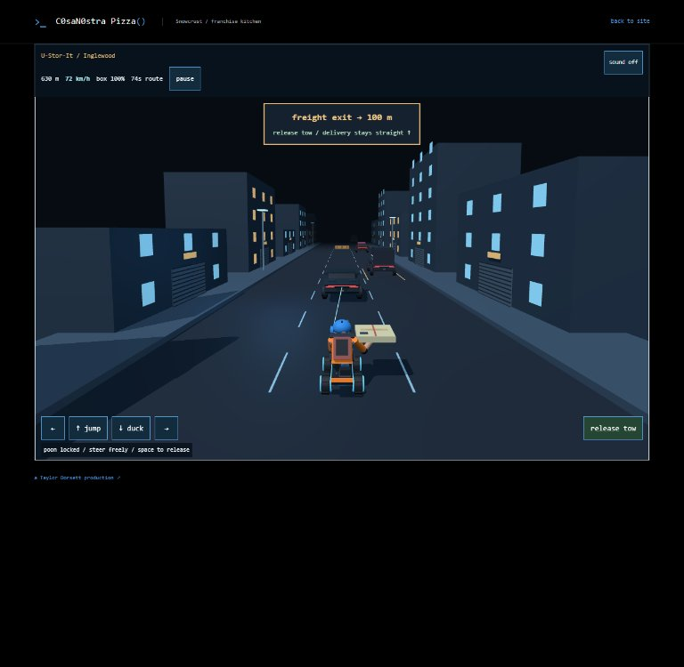
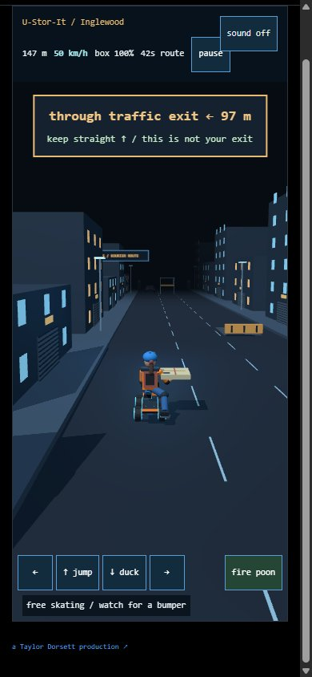
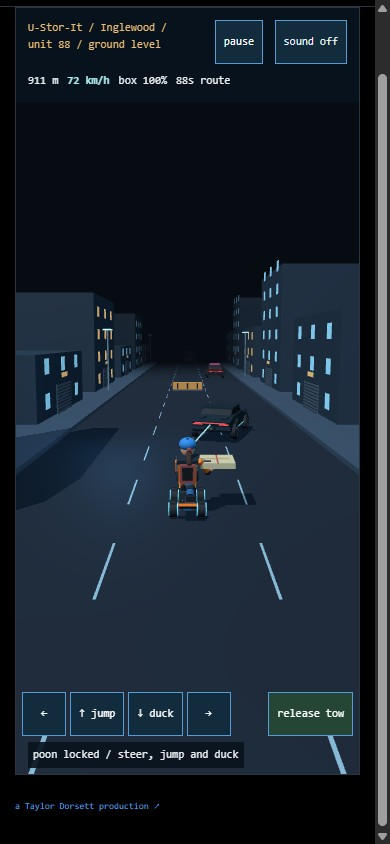
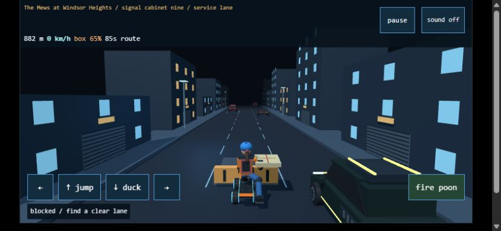
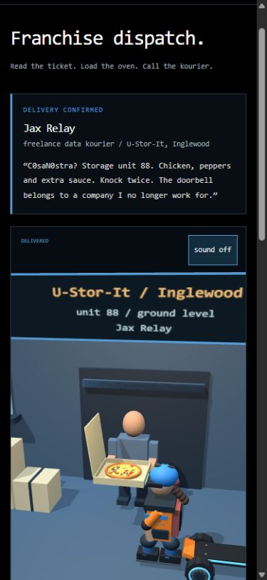

# interaction audit

reviewed November 15, 2026. covers the opening, exit, speed and control changes in PRs 60 through 63.

the previous version did not meet the intended behavior. the opening ended before the hook, a missed exit failed before the visible turn, decorative boxes looked interactive and traffic could lose pace. the earlier review leaned too heavily on a clean route.

## what changed

| problem                      | finding                                                                 | outcome                                                                   |
| ---------------------------- | ----------------------------------------------------------------------- | ------------------------------------------------------------------------- |
| opening tow missing          | interactive pickup stopped at 3.1 seconds                               | full pickup now finishes before the road starts attached                  |
| hard to see the exit         | signs were small and failure happened before the turn                   | separate road signs and a large direction and distance warning            |
| first car seemed required    | destination was already fixed, but recovery was slow and poorly checked | route remains independent and free skating can finish without another car |
| car slows behind traffic     | mixed speeds could form queues                                          | spaced traffic now cruises at 72 km/h                                     |
| boxes behind obstacles       | small boxes were decoration with no collection behavior                 | removed loose boxes behind barriers and by vans                           |
| phone pause overlaps sound   | controls shared the same corner                                         | separate positions with a browser regression check                        |
| landscape loses top controls | dismissing the prompt shifted the scroll position                       | resume brings the road back into view                                     |
| pause says already hooked    | opening instructions remained during every pause                        | that line only appears before the first start                             |

## how to read the checks

played means real inputs in the review browser with the relevant scene visually inspected. browser test means a scripted Chromium check. model test means simulation inputs without a renderer. inspection means the behavior was read in code and is not a play test.

phone review used browser viewport sizes, not physical phones. the review browser blocked on the native reset confirmation, so reset cancel and accept are covered by automated browser tests instead. that manual reset attempt is not counted as a pass.

## kitchen and pickup

| interaction                   | result                                                         | evidence and judgment                                                           |
| ----------------------------- | -------------------------------------------------------------- | ------------------------------------------------------------------------------- |
| select each topping and add 5 | all 14 worked, producing 66 extras                             | played and browser test. sauce is one covering layer, so this count makes sense |
| tap pizza to place            | topping appears on the pizza                                   | browser test. placement is tested separately from add 5                         |
| sauce                         | spreads as a layer and does not create five loose sauce pieces | browser sauce checks and kitchen review                                         |
| topping limit                 | stops at 80, undo returns to 79                                | browser test. no overflow                                                       |
| undo                          | removes the last extra                                         | played at 66 to 65 and browser test                                             |
| turn buttons                  | both directions rotate the pizza                               | played and recipe browser checks                                                |
| drag rotation                 | turns the pizza without placing an extra                       | browser test                                                                    |
| house special                 | replaces toppings with 23 preset extras                        | played and browser test. it does not claim to match the caller                  |
| reset cancel                  | pizza and mode stay unchanged                                  | browser test with a nonempty order                                              |
| reset accept                  | clears extras and returns to prep                              | browser test, including interrupted baking and pickup                           |
| bake                          | locks toppings, cooks in the oven, returns to prep bay         | played and browser tests                                                        |
| inspect and return            | slice separates and goes back                                  | browser test                                                                    |
| bite                          | one bite only, button then disables                            | browser test and scoring tests                                                  |
| dispatch                      | full pickup, hook and pull appear before the playable road     | played. camera follow was corrected after the first review lost the rider       |
| automatic delivery            | skips road control and still reaches handoff                   | browser test                                                                    |
| reduced motion                | retains the functional delivery and ending                     | browser test. no physical accessibility review claimed                          |

## road

| interaction            | result                                                          | evidence and judgment                                                                                |
| ---------------------- | --------------------------------------------------------------- | ---------------------------------------------------------------------------------------------------- |
| start                  | already attached and moving                                     | played and browser assertion for release tow                                                         |
| left and right         | one lane per input, outside lanes remain visible                | played with arrows, phone buttons and pointer swipes. model checks rapid reversals                   |
| jump                   | clears low barriers                                             | played and model tests                                                                               |
| duck                   | clears overhead frames                                          | played and model tests                                                                               |
| swipe up and down      | visible jump and crouch                                         | played with pointer gestures in a phone viewport. automated touch input also covers a sideways swipe |
| duck after jump        | cancels jump for the next beam                                  | model test and gesture review                                                                        |
| sustained tow          | opening stretch holds 72 km/h                                   | played. model requires at least 18 seconds on one car                                                |
| catch                  | flight, latch and acceleration                                  | browser route and model tests                                                                        |
| missed catch           | does not teleport or attach to a different lane                 | played and model test                                                                                |
| release                | line cuts and speed eases toward free skating                   | played and model test                                                                                |
| freight exit           | right turn, straight delivery direction, warning before arrival | played on desktop and phone                                                                          |
| late release           | car turns, line cuts, cargo loses 15 points and play continues  | deliberately played through the first exit, model checks both exits                                  |
| final junction         | through traffic leaves left, delivery continues straight        | played in phone view even after the replacement hook missed                                          |
| hit barrier            | box falls to 65 percent and rider stops before it               | deliberately played and model test                                                                   |
| leave barrier          | jump or change lanes frees the rider                            | played. waiting at the barrier does not drain cargo repeatedly                                       |
| traffic collision      | contact rejects overlap and applies damage                      | model tests. not every car family collision was separately played this pass                          |
| no replacement tow     | still reaches the address                                       | successful played run after a missed replacement hook, plus the model scenario below                 |
| pause and resume       | route and order time freeze, controls resume                    | played and browser tests                                                                             |
| landscape resume       | top controls remain visible after prompt closes                 | reproduced the bug, fixed it, then reviewed the corrected view and added a browser check             |
| timeout                | failure at 90 seconds with retry                                | played. a run with a long stop expired at 866 metres with 65 percent cargo                           |
| retry                  | starts attached again with the same pizza                       | played after timeout and browser test                                                                |
| cargo failure          | no input cannot silently earn delivery                          | model and browser tests                                                                              |
| slower road            | reduced speed, no damage, assisted label                        | played and complete browser practice run                                                             |
| sound toggle and pause | off by default, starts on request, mutes on pause               | browser audio graph tests. these do not judge the sound mix by ear                                   |

## doorstep and receipt

| interaction         | result                                         | evidence and judgment                                                                    |
| ------------------- | ---------------------------------------------- | ---------------------------------------------------------------------------------------- |
| approach            | slows into the correct forecourt               | played after the final junction                                                          |
| hand over           | waits for parking, then opens the actual pizza | played and browser tests                                                                 |
| customer reaction   | follows bite, condition, accuracy and timing   | browser tests across all six callers                                                     |
| score               | 0 to 100 for toppings, with a bite penalty     | unit and browser tests. the played house special correctly scored 0 for a chicken ticket |
| condition           | stays separate from topping accuracy           | played delivery finished at 100 percent condition despite the wrong toppings             |
| late order          | delivery still completes and says late         | played and browser tests. a road retry does not erase time already spent on the order    |
| replay              | keeps the original receipt and recorded time   | browser test                                                                             |
| practice            | another road run does not replace the receipt  | browser test                                                                             |
| next call           | new customer and fresh order                   | browser test                                                                             |
| reset at the door   | returns to prep with a fresh timer             | browser test                                                                             |
| repeated deliveries | reuse GPU buffers                              | browser test. not a long session memory profile                                          |

## recovery results

these are 32 scripted model scenarios, not 32 manual playthroughs. all use normal action calls and never write simulation state. the pilot avoids obstacles after the specified mistake. the first car counts as one catch because the run starts attached.

| scenario                  | arrived | seconds | condition | hits | catches |
| ------------------------- | ------- | ------- | --------- | ---- | ------- |
| clean delivery            | yes     | 54.22   | 100       | 0    | 2       |
| no replacement tow        | yes     | 71.31   | 100       | 0    | 1       |
| hit first barrier         | yes     | 54.22   | 65        | 1    | 2       |
| miss both exit releases   | yes     | 54.28   | 70        | 2    | 2       |
| wait fifteen seconds      | yes     | 82.16   | 65        | 1    | 1       |
| release at 0m, wait 2s    | yes     | 54.22   | 100       | 0    | 3       |
| release at 0m, wait 5s    | yes     | 54.22   | 100       | 0    | 2       |
| release at 0m, wait 10s   | yes     | 54.22   | 100       | 0    | 2       |
| release at 100m, wait 2s  | yes     | 54.22   | 100       | 0    | 3       |
| release at 100m, wait 5s  | yes     | 56.02   | 100       | 0    | 2       |
| release at 100m, wait 10s | yes     | 56.02   | 100       | 0    | 2       |
| release at 200m, wait 2s  | yes     | 54.22   | 100       | 0    | 3       |
| release at 200m, wait 5s  | yes     | 54.22   | 100       | 0    | 2       |
| release at 200m, wait 10s | yes     | 56.5    | 100       | 0    | 2       |
| release at 300m, wait 2s  | yes     | 54.22   | 100       | 0    | 3       |
| release at 300m, wait 5s  | yes     | 54.34   | 100       | 0    | 2       |
| release at 300m, wait 10s | yes     | 56.02   | 100       | 0    | 2       |
| release at 400m, wait 2s  | yes     | 54.22   | 100       | 0    | 2       |
| release at 400m, wait 5s  | yes     | 54.22   | 100       | 0    | 2       |
| release at 400m, wait 10s | yes     | 56.02   | 100       | 0    | 2       |
| release at 500m, wait 2s  | yes     | 54.22   | 100       | 0    | 2       |
| release at 500m, wait 5s  | yes     | 56.02   | 100       | 0    | 2       |
| release at 500m, wait 10s | yes     | 62.74   | 100       | 0    | 1       |
| release at 600m, wait 2s  | yes     | 54.22   | 100       | 0    | 3       |
| release at 600m, wait 5s  | yes     | 60.19   | 100       | 0    | 2       |
| release at 600m, wait 10s | yes     | 60.19   | 100       | 0    | 2       |
| release at 700m, wait 2s  | yes     | 54.22   | 100       | 0    | 3       |
| release at 700m, wait 5s  | yes     | 58.05   | 100       | 0    | 2       |
| release at 700m, wait 10s | yes     | 58.05   | 100       | 0    | 2       |
| release at 800m, wait 2s  | yes     | 55.91   | 100       | 0    | 2       |
| release at 800m, wait 5s  | yes     | 55.91   | 100       | 0    | 2       |
| release at 800m, wait 10s | yes     | 55.91   | 100       | 0    | 2       |

run `node scripts/audit-delivery.js` to regenerate the JSON in artifacts/delivery-audit.json.

an early recovery sweep failed near 710 metres. investigation showed that the test pilot refused a lane change that also needed a jump. the pilot now handles that combination. that failed pilot result was not proof of an unavoidable game trap.

the manual long stop failed for a different reason. it spent about 28 extra seconds at the opening barrier, then kept skating without another tow. the route remained usable, but the clock ran out. that is consistent with a timed game.

## evidence

## remaining limits

this is one authored route. the junctions are traffic exits, not selectable delivery branches. all customers share the road and have different doorsteps. there are no road collectibles.

physical iPhone and Android performance, Safari and Firefox, sound quality by ear and a long session performance profile remain unverified. the browser review does not establish a real device frame rate.

keyboard aliases, held key suppression and background tab pause are present in the input handler. arrows, space, pause buttons and gestures were exercised, but every keyboard alias and background browser combination was not separately tested in this pass. do not describe that as exhaustive input coverage.

the visual review did not show the earlier box through torso problem in the sampled pickup, road and handoff poses. it cannot prove that every possible pose is free of clipping. mathematical clearance tests cover the modeled grip and cargo positions.

there is no restart button during an active healthy run. pause offers resume and the slower road option. retry appears after failure, and reset returns at the door. that is usable, but a pause menu restart would make experimentation easier.

this pass fixes the reported rules and presentation failures. it does not establish the polish of a commercial runner or finish the device testing. the [spec](DELIVERY_SPEC.md) is the standard for the next review too.
