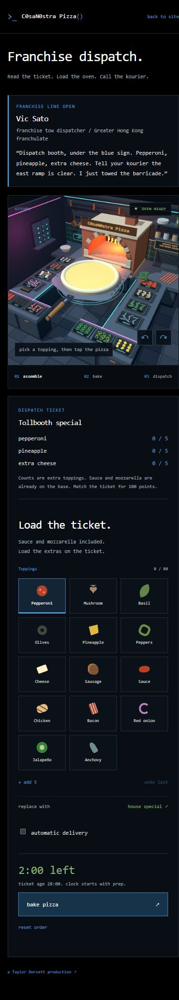
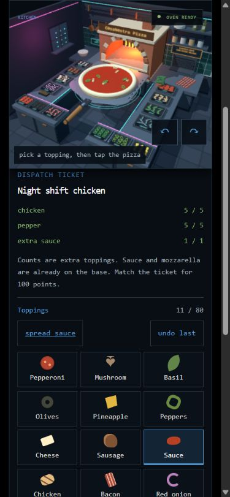
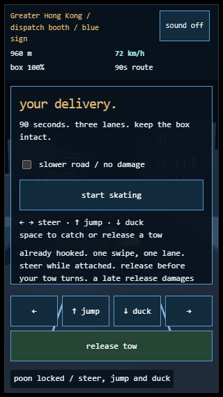
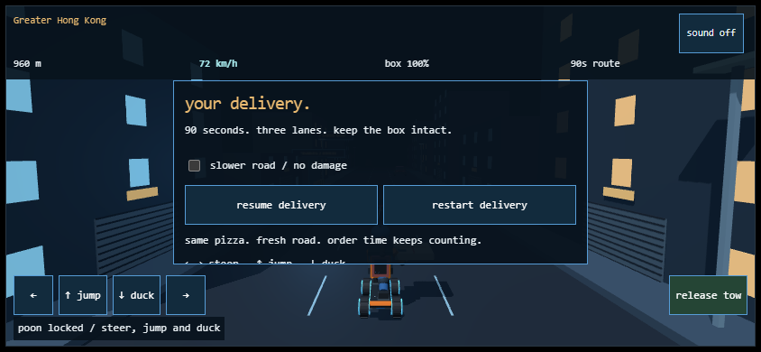

# mobile review

## what was wrong

at 390 by 844, the kitchen page was about 2,100 pixels tall. the pizza sat above the ticket and five rows of toppings. choosing toppings meant scrolling away from the pizza. adding a batch and baking required more scrolling. several labels were 9 or 10 pixels and the rotate buttons were only 33 pixels wide.

at 320 by 568, the road prompt covered the driving controls. the single row of buttons was wider than the scene, clipping the tow button. start and restart came after the instructions inside a scrolling prompt. the page itself could also scroll during the ride, hiding the top of the HUD.

the previous phone review established that the flow completed. it did not establish that the whole layout was comfortable to use.

## changes

the kitchen preview stays visible while the controls scroll. topping labels are larger, the picker is shorter and batch actions sit above it. rotate, undo, reset and other secondary actions have at least 44 pixel targets. short landscape screens put the kitchen and controls beside each other.

dispatch brings the pickup scene into view. the road uses the available screen with separate space for the HUD, prompt and controls. narrow phones get two rows of controls. start, resume and restart come before the instructions. the prompt can scroll without covering the controls. the receipt uses a shorter handoff scene so the result is easier to reach.

the responsive rules live in `src/styles/mobile.css`. desktop styling remains in the existing stylesheets. the small markup changes keep keyboard focus order aligned with the visible action order.

## checks

`tests/browser/mobile-layout-check.js` runs in the kitchen browser suite. it checks 320 by 568, 390 by 844, 844 by 390 and 768 by 1024. it checks pizza visibility after selecting and adding toppings, pickup visibility, usable button sizes, start and restart visibility, prompt clearance and horizontal overflow. the normal browser suites cover baking, slice inspection, delivery, failure, retry, handoff and reset.

browser screenshots are reviewed separately. viewport checks do not establish physical phone performance, browser toolbar behavior or Safari support.

