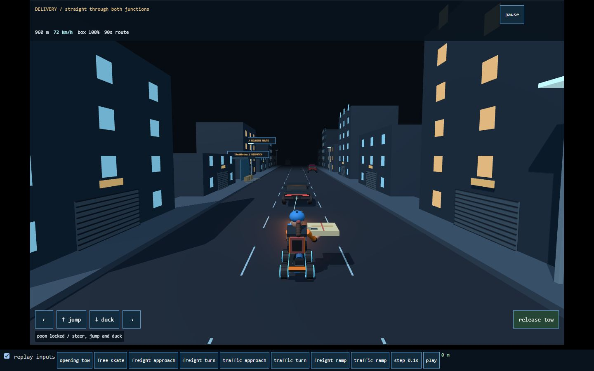
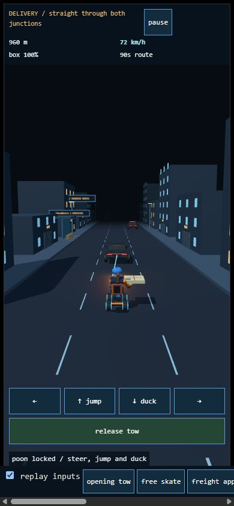
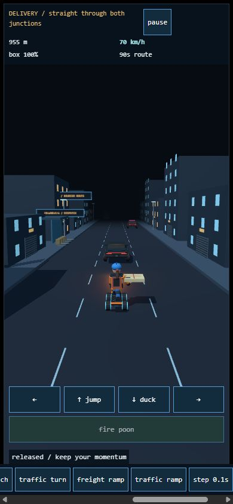

# towing feel

Towing, coasting and pushing now have different poses. A catch builds the braced stance over a short transition. Release keeps both feet on the board until speed drops enough to start pushing again. The camera opens with actual speed, so release keeps the fast view while momentum lasts. Reduced motion keeps a fixed camera view.

The cable flies, tightens and reels back. A missed shot has an amber line and never attaches to a car in another lane. The bumper marker stays hidden during cooldown. The old release endpoint is retained during retraction so the line cannot jump to a new target.

Road speeds, collision rules, tow duration and release momentum are unchanged. `ride-feel.js` defines presentation from speed and tow load. `tow-line.js` owns the reusable cable geometry. The run model updates the small tow load transition on its fixed simulation steps, so pause freezes it too.

## review outcomes

| interaction             | observed result                                                                                                         | assessment                                 |
| ----------------------- | ----------------------------------------------------------------------------------------------------------------------- | ------------------------------------------ |
| sustained tow           | recorded inputs kept the opening tow at cruise through the first section, then released before the freight ramp         | towing remains useful beyond a short burst |
| release                 | manual desktop and phone checks retained about 70 km/h after 0.3 seconds, with feet on the board and the line retracted | momentum and pose agree                    |
| catch from free skating | hook flight preceded attachment, then speed and stance built together                                                   | no instant speed jump                      |
| missed hook             | firing in the left lane missed the center car and showed an amber shot                                                  | a miss stays a miss                        |
| recovery after miss     | moving back to the center and firing after cooldown caught the car                                                      | recovery remains understandable            |
| phone recatch           | release, cooldown and another catch worked with the visible touch buttons                                               | no extra control needed                    |
| landscape               | rider, cargo, cable and controls remained visible while the replay moved                                                | no clipping found in the reviewed view     |

Reviewed in Chrome at desktop size, 390 by 844 and 844 by 390. These are browser viewports, not physical phones. The local replay uses the real model and renderer. It does not replace the full browser suites or prove physical device performance.

Run `node scripts/review-junctions.js` and open `/junction-review.html`. Use opening tow or free skate, then play. Replay inputs handles the established route. A manual game input turns replay off. The step button advances 0.1 seconds for inspecting hook flight and retraction. All of these review controls stay out of the normal build.

## checks

Unit coverage includes speed cues, coasting feet, catch acceleration, pause, reduced motion framing, sustained towing and recovery. The recovery audit exercises 32 routes, including release delays, missed exits, a hit and no replacement tow. The browser suites cover the complete delivery flow and repeated runs.

