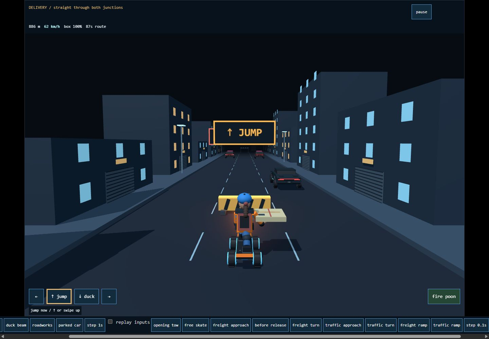
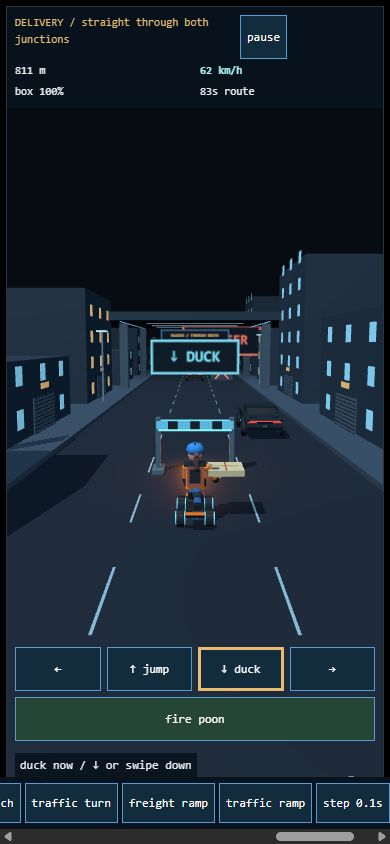
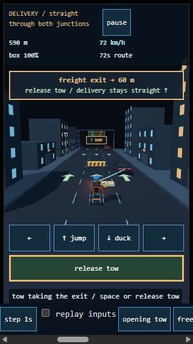
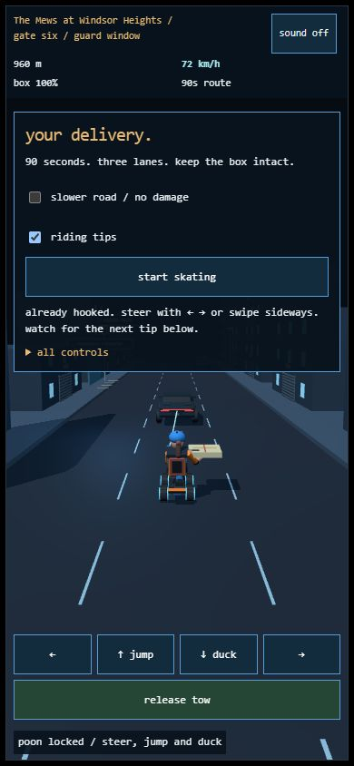
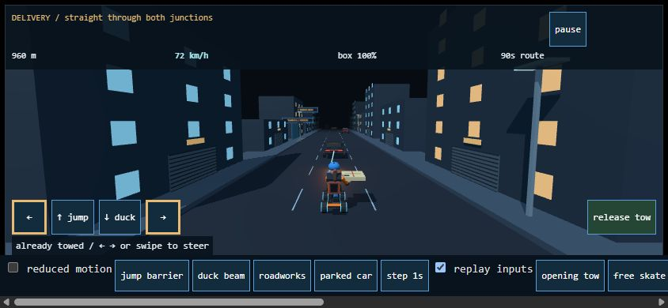

# opening ride review

issue 72. checked in Chrome on November 20, 2026.

## what changed

the start panel gives one steering instruction. all controls are still available in a foldout. riding tips can be turned off in the pause menu and that choice stays for retries in the same page session.

tips follow the actual lane, obstacle and tow car. there is no forced sequence to get stuck in after a hit or early release. hits, recovery, pause and arrival suppress lesson highlights. exits keep their separate route warning.

the first ride still plays the pickup before starting attached at speed. no changes to pickup timing, traffic, collisions or road speed.

## confusing bits found

1. the old start screen asked you to remember everything at once. it now shows steering first and introduces the other controls on the road.
2. an early version of the jump cue passed with instant input but failed with a 200 ms reaction delay. the cue now starts earlier. the model test clears both opening obstacles with that delay.
3. the phone start panel filled the available height even with less text. it now fits its content and scrolls only when needed. landscape puts the two options beside each other.

## outcomes

| check                   | outcome                                                                                                           |
| ----------------------- | ----------------------------------------------------------------------------------------------------------------- |
| desktop steering hint   | visible below the controls with both steering buttons outlined                                                    |
| jump cue                | used the actual jump button in the review scene, stepped past the barrier with box at 100%                        |
| duck cue                | used the actual duck button at phone size, stepped past the beam with box at 100%                                 |
| release                 | released before the freight exit and steered clear, box stayed at 100%, route warning changed to keep straight    |
| another catch           | used fire poon with a reachable bumper, control changed to release tow                                            |
| normal pickup flow      | observed the street pickup and the attached road start through the regular kitchen flow                           |
| phone portrait          | 390 by 844 and 320 by 568 checked visually, hints and buttons fit without covering the rider                      |
| phone landscape         | 844 by 390 checked visually, hints stay below controls and the pause panel scrolls                                |
| tips off                | removed lesson outlines and restored normal road messages                                                         |
| automated delivery flow | desktop and phone layouts passed steering, swipes, pause, restart, collision recovery, arrival and receipt checks |
| model checks            | 108 passed, including tutorial priority and jump and duck cues with a reaction delay                              |

## limits

the focused interaction checks use the local review scene and time stepping. the full delivery tests replay inputs. these are not a claim of completing a whole run manually in real time.

i know the controls already. a first run review by someone who has never played is still needed. no physical phone was tested here. that remains issue 73.

## screenshots

